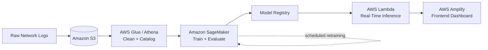

# 🛡️ Real-Time Cyberattack Detection on AWS

> A scalable, cloud-native machine learning pipeline that detects and classifies network attacks in real time, with automated retraining to stay ahead of evolving threats.


---

## 📑 Table of Contents
- [Overview](#-overview)
- [Problem Statement](#-problem-statement)
- [Architecture](#-architecture)
- [Tech Stack](#-tech-stack)
- [Data Pipeline](#-data-pipeline)
- [Modeling Approach](#-modeling-approach)
- [Results](#-results)
- [Getting Started](#-getting-started)
- [Future Work](#-future-work)

---

## 🔭 Overview
Modern networks generate **millions of log events every day**, yet only a tiny fraction represent genuine attacks. Finding them quickly is essential for **security monitoring, incident response, and forensics**.

This project builds an end-to-end ML pipeline on AWS that:
- Ingests high-volume network logs
- Classifies traffic across **multiple attack categories** (not just "attack vs. normal")
- Serves predictions at **low latency** through serverless inference
- **Retrains automatically** to limit model drift

| | |
|---|---|
| **Dataset** | UNSW-NB15 (raw network traffic features) |
| **Task** | Multi-class classification |
| **Primary model** | XGBoost |
| **Inference** | AWS Lambda (serverless) |
| **Retraining** | SageMaker Pipelines |

---

## 🎯 Problem Statement

### Why it matters
Traditional rule-based systems (signature matching, static thresholds) are:
- ❌ Slow to update and hard to scale
- ❌ Blind to **zero-day and novel attacks**
- ❌ Inefficient on very large log volumes

### Objective
Build a **highly scalable ML system** that analyzes network logs in real time and accurately **detects and classifies attack types**.

### Value delivered
- ✅ Low-latency, actionable threat insights
- ✅ Proactive, automated security management
- ✅ Models that adapt as traffic patterns change

---

## 🏗️ Architecture



---

## 🧰 Tech Stack

| Layer | Service / Tool | Purpose |
|---|---|---|
| Storage | **Amazon S3** | Raw and processed network logs |
| ETL / Catalog | **AWS Glue, Athena** | Cleaning, cataloging, ad-hoc SQL |
| ML Platform | **Amazon SageMaker** | Training, tuning, deployment, pipelines |
| Inference | **AWS Lambda** | Serverless real-time predictions |
| Frontend | **AWS Amplify** | Surfacing predictions to users |
| Libraries | `xgboost`, `pandas`, `scikit-learn`, `boto3` | Modeling and data handling |

---

## 🧹 Data Pipeline

| Step | Stage | Details |
|:---:|---|---|
| 1 | **Ingestion** | Load UNSW-NB15 from the S3 `network-intrusion` bucket via `boto3` |
| 2 | **Cleaning** | Drop non-predictive columns (`id`) and separate label columns (`attack_cat`) |
| 3 | **Outlier handling** | Compare each numeric feature's max vs. median; if `max > 10 × median`, cap values at the **95th percentile** |
| 4 | **Validation** | Confirm distributions with `df.describe()` |
| 5 | **Model readiness** | Dataset is ready for scaling, encoding, and SageMaker training |

<details>
<summary><b>Outlier capping logic</b></summary>

```python
for col in numeric_cols:
    if df[col].max() > 10 * df[col].median():
        cap = df[col].quantile(0.95)
        df[col] = df[col].clip(upper=cap)
```
</details>

---

## 🤖 Modeling Approach
- **Algorithm:** XGBoost — fast, accurate, and well suited to structured/tabular data
- **Task:** Multi-class attack classification
- **Benchmarking:** Compared against **5 alternative model architectures**
- **Continuous retraining:** SageMaker Pipelines retrain on fresh data to counter **model drift** and adapt to new threats

---

## 📊 Results
- ✅ Real-time cyberattack detection model benchmarked across 5 architectures
- ✅ Multi-class classification across attack categories
- ✅ Real-time inference via **AWS Lambda**
- ✅ Automated retraining via **SageMaker Pipelines**
- ✅ Fully automated, scalable, cloud-based intrusion detection

> 💡 *Add your metrics here, e.g. accuracy, macro F1, per-class recall, inference latency.*

| Model | Accuracy | Macro F1 | Latency (ms) |
|---|:---:|:---:|:---:|
| XGBoost | – | – | – |
| Model 2 | – | – | – |
| Model 3 | – | – | – |

---

## 🚀 Getting Started

```bash
# Clone the repository
git clone https://github.com/<your-username>/<repo-name>.git
cd <repo-name>

# Install dependencies
pip install -r requirements.txt

# Configure AWS credentials
aws configure

# Run preprocessing
python src/preprocess.py
```

---

## 🔮 Future Work
- [ ] Add SHAP-based explainability for each prediction
- [ ] Streaming ingestion with Kinesis for true real-time logs
- [ ] Model monitoring and drift alerts with SageMaker Model Monitor
- [ ] Infrastructure as Code (CloudFormation / Terraform)
- [ ] CI/CD for automated model deployment

---

## 📄 License
Distributed under the MIT License.
